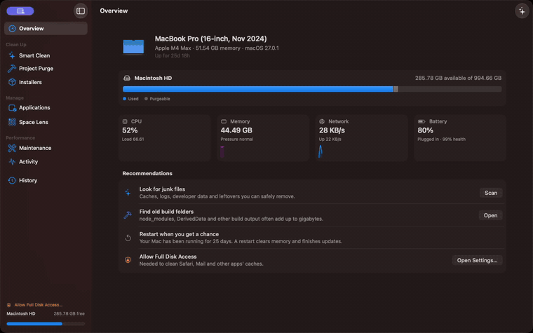
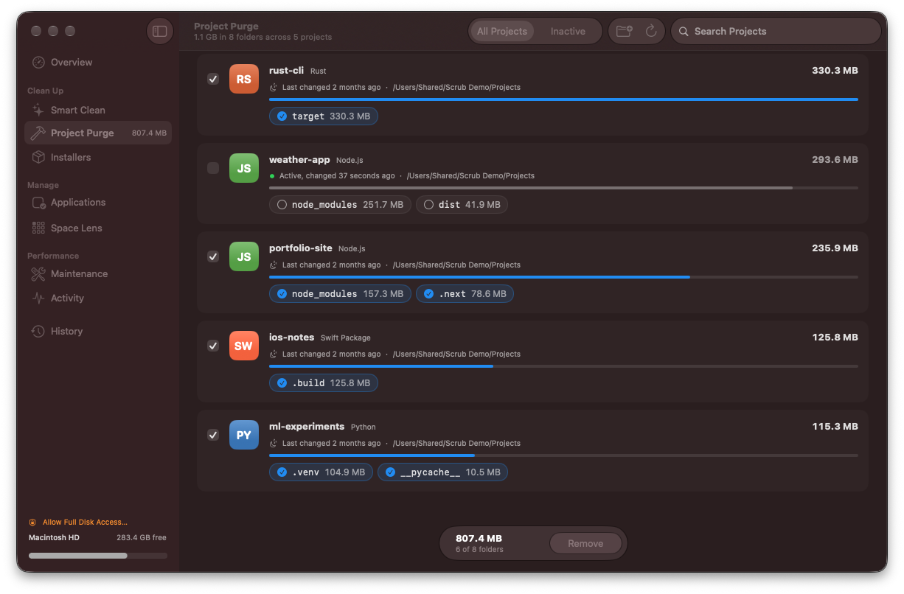
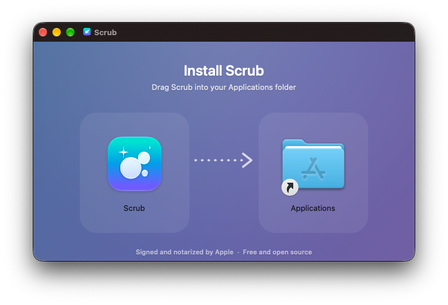

<p align="center">
  
</p>

<h1 align="center">Scrub</h1>

<p align="center">
  <b>A free, open-source Mac cleaner and optimizer, built natively for macOS Tahoe with Liquid Glass.</b><br>
  Clean caches and junk, uninstall apps completely, map your disk, run maintenance and watch your Mac live.
</p>

<p align="center">
  <a href="https://github.com/nearbycoder/scrub/releases/latest/download/Scrub.dmg"><b>Download Scrub.dmg</b></a> ·
  <a href="https://nearbycoder.github.io/scrub/">Website</a> ·
  <a href="#install">Install</a> ·
  <a href="#what-scrub-removes">What it removes</a>
</p>

<p align="center">
  <a href="https://nearbycoder.github.io/scrub/media/scrub-demo.mp4">
    
  </a>
  <br><sub><a href="https://nearbycoder.github.io/scrub/media/scrub-demo.mp4">Watch the full demo (MP4, 84 seconds)</a></sub>
</p>

## Features

| | |
|---|---|
| **Smart Clean** | Covers user and system caches, logs, crash reports, temporary files, browser caches (Safari, Chrome, Edge, Brave, Arc, Firefox, Opera, Vivaldi), developer junk (Xcode DerivedData, simulator caches, device support, Homebrew, npm, Yarn, pnpm, Bun, pip, uv, CocoaPods, Gradle, Cargo, Go), chat and AI app caches, old installers, leftovers from deleted apps, and the Trash. Each category shows its app's icon, a plain-language explanation, a safety rating, and a sortable list of every file, so you can review everything before anything is removed. |
| **Applications** | A sortable, searchable table of your apps. The inspector lists everything an app leaves behind (Application Support, Caches, Preferences, Containers, Saved State, WebKit, Cookies, HTTP storage, Launch Agents and Daemons, privileged helpers, and vendor folders like `Google/Chrome`). You can uninstall the app or just reset its data. Everything goes to the Trash. |
| **Space Lens** | A treemap of any folder or drive, with back and forward navigation, a Finder-style path bar, and a largest-files table. You can show items in Finder or move them to the Trash. |
| **Maintenance** | Rebuilds the Quick Look and Launch Services caches, removes broken launch agents, repairs damaged preference files, clears the download history log, resets font caches, compacts Mail's index, deletes unavailable simulators and runs Homebrew cleanup. It can also flush DNS, free memory, thin Time Machine snapshots, rebuild the icon cache, repair home folder permissions and reindex Spotlight. Admin tasks share **one** password prompt. |
| **Touch ID for sudo** | One switch writes `/etc/pam.d/sudo_local`, which survives macOS updates. |
| **Activity** | CPU (per core), memory breakdown and pressure, swap, disk I/O, network, GPU, battery health, cycle count and power, plus a process table you can sort and quit processes from. |
| **Project Purge** | Finds `node_modules`, `target`, `.build`, `build`, `dist`, `.next`, `DerivedData`, `__pycache__`, `venv`, `Pods` and more across your project folders. Each project appears as a card showing its stack (Node.js, Rust, Swift, Python and others), when it last changed, and a toggle for each build folder. Folders that git tracks are protected, and recently active projects start unselected. |
| **Installers** | Finds `.dmg`, `.pkg`, `.iso`, `.xip` and installer `.zip` files in Downloads, Desktop, Documents, iCloud Drive, Mail and the Homebrew cache. |
| **Menu bar** | Live meters, Smart Scan and Free Up Memory. |
| **History** | A log of every cleanup: what was removed, from where, and how much space it freed. |
| **Updates** | Scrub checks GitHub for new releases once a day and installs them in place. An update is only installed if it's notarized by Apple and signed by the same developer. |

### Native by design

Scrub uses standard macOS building blocks: a source-list sidebar, unified toolbars with titles and subtitles, `Table` outlines with sortable columns, inspectors, grouped forms, and the system's empty and progress states. Liquid Glass appears only where macOS uses it, on the control layer: the toolbar, the sidebar, and floating controls such as the action bar and the Space Lens hover label. Content stays plain and readable.

### Fast

- **Parallel disk walker.** Scrub reads directories with `getattrlistbulk(2)`, which returns names, types, sizes and dates for a whole batch of entries in one system call. Work is spread over a pool of threads, and hard links are counted once. Mapping a 240 GB `~/Library` with about 900,000 files takes about 12 s, against 35 s for an `fts` walk and 46 s for `du`.
- **One pass for Smart Clean.** Every rule's candidates are listed first, then measured together in a single parallel walk, which covers about 700,000 files in roughly 15 s.
- **Cheap treemap.** The treemap is drawn in a single `Canvas`. Layout is computed once per folder and size, and hovering only redraws a highlight.
- **Idle means idle.** Live sampling runs only while Overview, Activity or the menu bar panel is open. Process stats come from `libproc` instead of spawning `ps`, and unchanged values don't trigger redraws. With no window showing live data, Scrub sits at 0% CPU.

<table>
  <tr>
    <td></td>
    <td></td>
  </tr>
  <tr>
    <td></td>
    <td></td>
  </tr>
  <tr>
    <td></td>
    <td></td>
  </tr>
  <tr>
    <td colspan="2"></td>
  </tr>
</table>

## Install

**One line** (downloads the latest release and installs it to `/Applications`):

```sh
curl -fsSL https://raw.githubusercontent.com/nearbycoder/scrub/main/install.sh | bash
```

**Or download the installer:** open [Scrub.dmg](https://github.com/nearbycoder/scrub/releases/latest/download/Scrub.dmg) and drag Scrub to Applications. A [ZIP](https://github.com/nearbycoder/scrub/releases/latest/download/Scrub.zip) is also available.

<p align="center"></p>

The app is signed with a Developer ID certificate and notarized by Apple, and the disk image is notarized too, with tickets stapled to both. Scrub opens like any other app you download. To check a copy yourself, run `spctl -a -vv /Applications/Scrub.app`, which should report `source=Notarized Developer ID`. After that, Scrub keeps itself up to date (**Scrub → Check for Updates…**).

**Requirements:** macOS 26 Tahoe or later. Universal binary for Apple silicon and Intel.

### Full Disk Access (recommended)

Without Full Disk Access, macOS shows a privacy prompt whenever an app reads another app's data. Scrub skips those locations rather than interrupting you with dialogs. To include Safari, Mail and sandboxed app caches, add Scrub under **System Settings → Privacy & Security → Full Disk Access**. The sidebar has a shortcut.

## What Scrub removes

Scrub is built to be cautious:

- **Preview first.** Nothing is removed until you review it and press the button. Every category expands to show each file and folder with its size.
- **Hard safety rails.** A built-in path guard refuses `/System`, `/usr`, `/bin`, `/Library`, `/Applications`, your home folder, and top-level folders like Documents, Desktop, Downloads and `~/Library`. Symlinked parent folders are resolved before the check, folder walks never follow symlinks, and links that lead off the startup disk are skipped.
- **Running apps are skipped.** Caches of open apps, and browser caches while the browser is open, are left alone.
- **Protected items.** Right-click anything and choose *Always Protect This Item*, or manage the list in Settings.
- **Trash when it matters.** Apps, leftovers, installers, backups and anything from Space Lens go to the Trash. Regenerable caches are deleted directly by default, and you can switch them to the Trash in Settings.
- **Conservative defaults.** Package-manager caches, Xcode archives, device backups and leftovers of removed apps start *unselected*. Leftovers are only listed when no installed app from the same vendor exists and nothing has written to them in 15 days.
- **Full history.** Every run is logged, with paths, in *History*.

## Build from source

```sh
brew install xcodegen
git clone https://github.com/nearbycoder/scrub.git && cd scrub
xcodegen generate
open Scrub.xcodeproj          # or build from the command line:
./scripts/build-release.sh    # → dist/Scrub.dmg and dist/Scrub.zip
```

You'll need Xcode 26 or later. Run the tests with `xcodebuild -project Scrub.xcodeproj -scheme Scrub test`.

### Project layout

```
Scrub/
  App/         App entry, navigation shell, onboarding
  Core/        File sizing (fts), path guard, removal, shell/admin execution, settings, history
  Features/    Overview, Clean, Uninstall, Analyze, Optimize, Status, Purge, Installers, History, Settings, MenuBar
  UI/          Design system: section palette, glass cards, gauges, sparklines, scanning orb
  Resources/   Icon Composer app icon (Liquid Glass), asset catalog, Info.plist
ScrubTests/    Safety and layout tests
docs/          GitHub Pages site
```

Cleanup rules live in [`CleanCatalog.swift`](Scrub/Features/Clean/CleanCatalog.swift), so adding support for another app is usually a few lines. Pull requests are welcome.

### Demo mode

`Scrub.app/Contents/MacOS/Scrub -demo YES` plays a captioned tour of the app, which is how the video above was recorded. It never cleans real files. Project Purge only runs against folders you pass with `-projectRoots '("/path/to/sample/projects")'`.

## Releasing

Releases are built on a Mac that's signed in to Xcode with a Developer Program account:

```sh
SCRUB_TEAM_ID=YOURTEAMID ./scripts/build-release.sh 1.2.0   # archive, Developer ID sign, notarize, staple
gh release create v1.2.0 dist/*
```

The script uses Xcode's cloud-managed Developer ID certificate and the account signed in to Xcode, so it doesn't need a local certificate or a password. It builds the drag-to-install disk image with [dmgbuild](https://github.com/dmgbuild/dmgbuild), using a background rendered by `scripts/render-dmg-background.swift`. It notarizes and staples the disk image with a `notarytool` keychain profile named `scrub-notary`, or with `SCRUB_NOTARY_PROFILE`, or with `SCRUB_NOTARY_KEY`, `SCRUB_NOTARY_KEY_ID` and `SCRUB_NOTARY_ISSUER`. If a Developer ID identity with a local private key is in the keychain, the disk image is code-signed as well. Without `SCRUB_TEAM_ID`, the script makes an ad-hoc signed build. That's what [CI](.github/workflows/ci.yml) does on every push.

## Acknowledgements

Inspired by [Mole](https://github.com/tw93/Mole) and the commercial Mac cleaners. Scrub is an independent, from-scratch implementation.

## License

[MIT](LICENSE)
