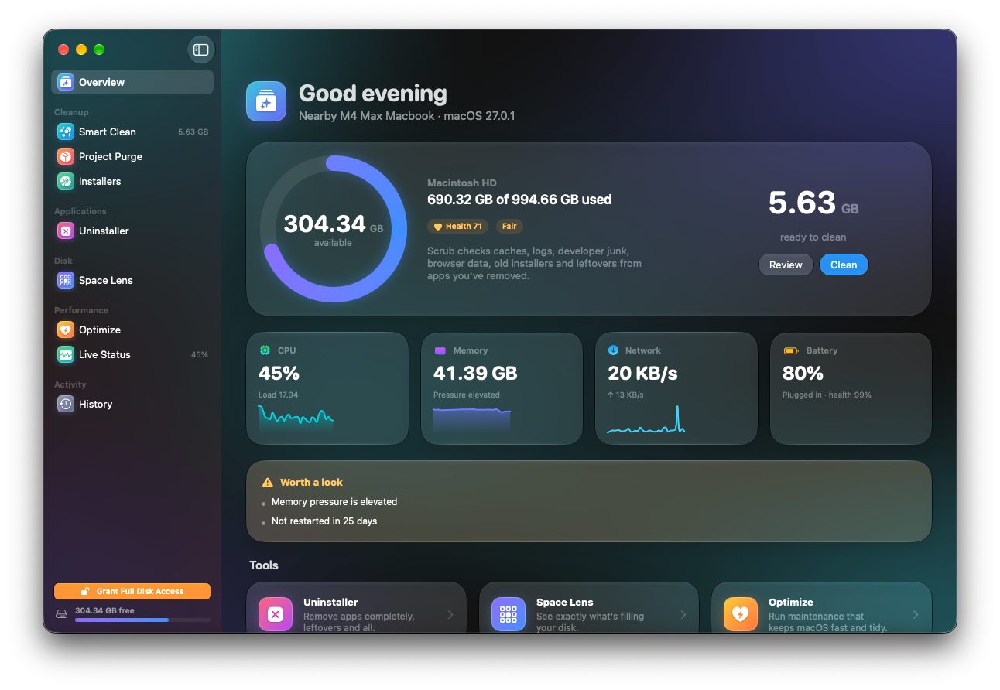
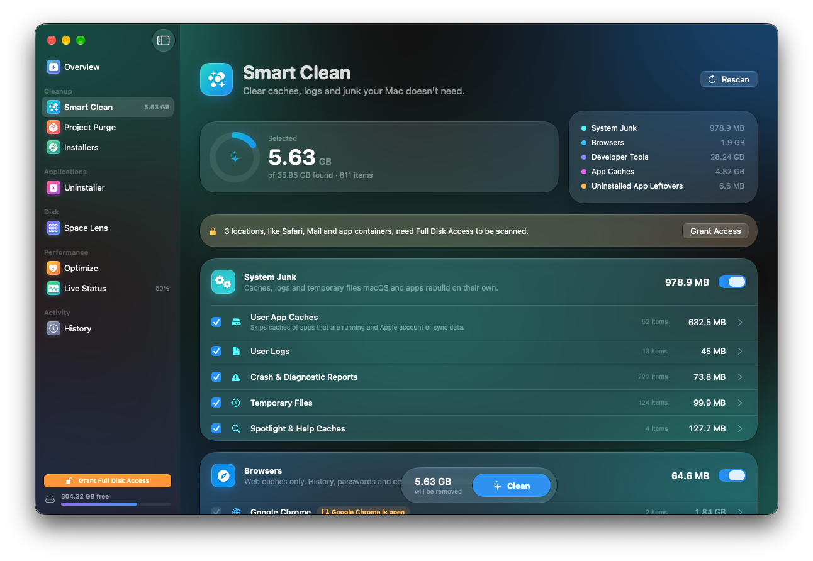
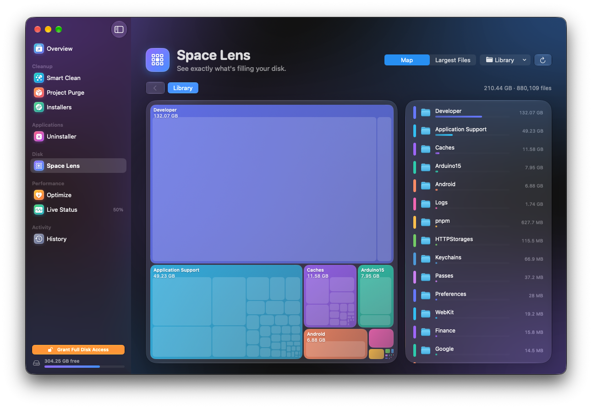
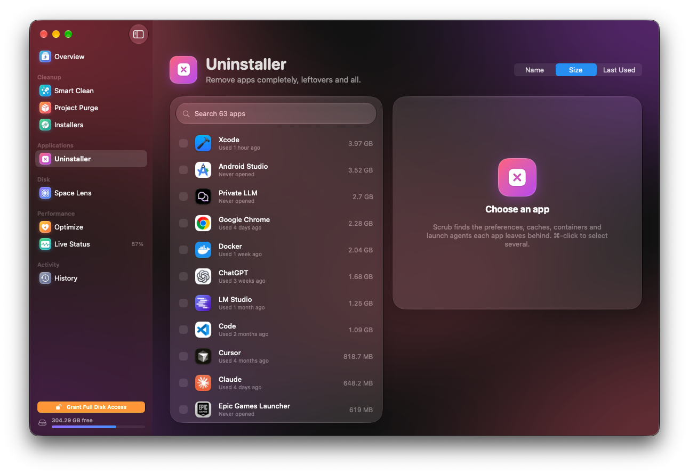
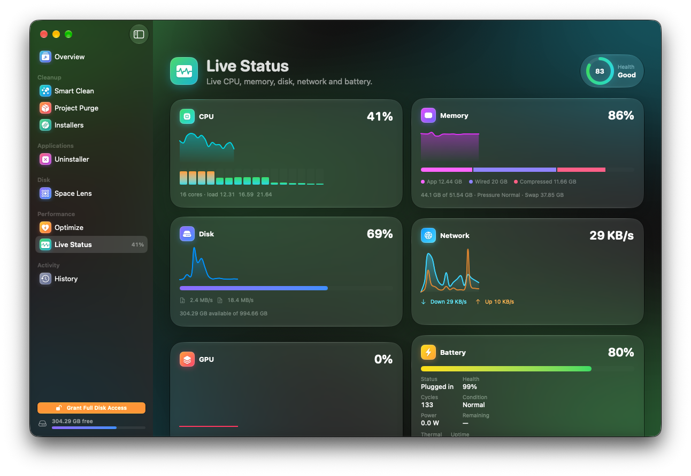
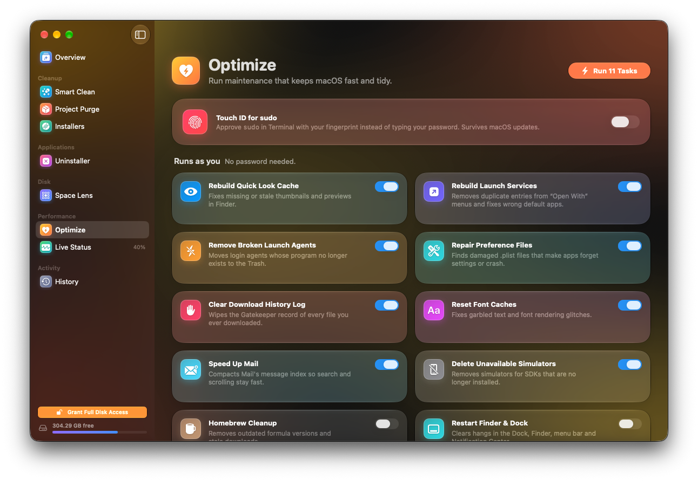

<p align="center">
  
</p>

<h1 align="center">Scrub</h1>

<p align="center">
  <b>A free, open-source Mac cleaner and optimizer, built natively for macOS Tahoe with Liquid Glass.</b><br>
  Clean caches and junk, uninstall apps completely, map your disk, run maintenance and watch your Mac live.
</p>

<p align="center">
  <a href="https://github.com/nearbycoder/scrub/releases/latest/download/Scrub.dmg"><b>Download Scrub.dmg</b></a> ·
  <a href="https://nearbycoder.github.io/scrub/">Website</a> ·
  <a href="#install">Install</a> ·
  <a href="#what-scrub-removes">What it removes</a>
</p>

<p align="center">
  
</p>

## Features

| | |
|---|---|
| **Smart Clean** | User and system caches, logs, crash reports, temporary files, browser caches (Safari, Chrome, Edge, Brave, Arc, Firefox, Opera, Vivaldi), developer junk (Xcode DerivedData, simulator caches, device support, Homebrew, npm, Yarn, pnpm, Bun, pip, uv, CocoaPods, Gradle, Cargo, Go), chat and AI app caches, old installers, leftovers of removed apps and the Trash. Every item can be reviewed before anything is removed. |
| **Uninstaller** | Removes an app together with its Application Support, Caches, Preferences, Containers, Group Containers, Saved State, WebKit data, Cookies, HTTP storage, Launch Agents/Daemons, privileged helpers and Dock tile. You can also reset an app's data and keep the app. Everything goes to the Trash. |
| **Space Lens** | An interactive treemap of any folder or drive. You can drill down, use breadcrumbs, see the largest files (with an "unused for a year" flag), reveal items in Finder or move them to the Trash. |
| **Optimize** | Rebuilds the Quick Look and Launch Services caches, removes broken launch agents, repairs damaged preference files, clears the download history log, resets font caches, compacts Mail's index, deletes unavailable simulators and runs Homebrew cleanup. It can also flush DNS, free memory, thin Time Machine snapshots, rebuild the icon cache, repair home folder permissions and reindex Spotlight. Admin tasks share **one** password prompt. |
| **Touch ID for sudo** | One switch writes `/etc/pam.d/sudo_local`, which survives macOS updates. |
| **Live Status** | CPU (per core), memory breakdown and pressure, swap, disk usage and I/O, network throughput, GPU, battery health, cycles and power, thermal state, uptime, and top processes you can quit. The window also shows a health score. |
| **Project Purge** | Finds `node_modules`, `target`, `.build`, `build`, `dist`, `.next`, `DerivedData`, `__pycache__`, `venv`, `Pods` and more across your project folders. Folders that git tracks are protected, and recently active projects start unselected. |
| **Installers** | Finds `.dmg`, `.pkg`, `.iso`, `.xip` and installer `.zip` files in Downloads, Desktop, Documents, iCloud Drive, Mail, Telegram and the Homebrew cache. |
| **Menu bar** | Live stats at a glance, Smart Scan and Free RAM. |
| **History** | A log of every cleanup: what was removed, from where, and how much space it freed. |

<table>
  <tr>
    <td></td>
    <td></td>
  </tr>
  <tr>
    <td></td>
    <td></td>
  </tr>
  <tr>
    <td colspan="2"></td>
  </tr>
</table>

## Install

**One line** (downloads the latest release, installs it to `/Applications` and clears the quarantine flag):

```sh
curl -fsSL https://raw.githubusercontent.com/nearbycoder/scrub/main/install.sh | bash
```

**Or download it yourself:** [Scrub.dmg](https://github.com/nearbycoder/scrub/releases/latest/download/Scrub.dmg) or [Scrub.zip](https://github.com/nearbycoder/scrub/releases/latest/download/Scrub.zip). Drag Scrub to Applications, then run:

```sh
xattr -dr com.apple.quarantine /Applications/Scrub.app
```

You can also open it once, then go to **System Settings → Privacy & Security** and click **Open Anyway**.

> Scrub is ad-hoc signed and not notarized, because notarization requires a paid Apple Developer account. That's why macOS asks you to approve it once. The source is all here, and you can build it yourself in a minute (see below).

**Requirements:** macOS 26 Tahoe or later. Universal binary for Apple silicon and Intel.

### Full Disk Access (recommended)

Without Full Disk Access, macOS shows a privacy prompt whenever an app reads another app's data. Scrub skips those locations rather than interrupting you with dialogs. To include Safari, Mail and sandboxed app caches, add Scrub under **System Settings → Privacy & Security → Full Disk Access**. The sidebar has a shortcut.

## What Scrub removes

Scrub is built to be cautious:

- **Preview first.** Nothing is removed until you review it and press the button. Every category expands to show each file and folder with its size.
- **Hard safety rails.** A built-in path guard refuses `/System`, `/usr`, `/bin`, `/Library`, `/Applications`, your home folder, and top-level folders like Documents, Desktop, Downloads and `~/Library`. Symlinked parent folders are resolved before the check, folder walks never follow symlinks, and links that lead off the startup disk are skipped.
- **Running apps are skipped.** Caches of open apps, and browser caches while the browser is open, are left alone.
- **Protected items.** Right-click anything and choose *Always Protect This Item*, or manage the list in Settings.
- **Trash when it matters.** Apps, leftovers, installers, backups and anything from Space Lens go to the Trash. Regenerable caches are deleted directly by default, and you can switch them to the Trash in Settings.
- **Conservative defaults.** Package-manager caches, Xcode archives, device backups and leftovers of removed apps start *unselected*. Leftovers are only listed when no installed app from the same vendor exists and nothing has written to them in 15 days.
- **Full history.** Every run is logged, with paths, in *History*.

## Build from source

```sh
brew install xcodegen
git clone https://github.com/nearbycoder/scrub.git && cd scrub
xcodegen generate
open Scrub.xcodeproj          # or build from the command line:
./scripts/build-release.sh    # → dist/Scrub.dmg and dist/Scrub.zip
```

You'll need Xcode 26 or later. Run the tests with `xcodebuild -project Scrub.xcodeproj -scheme Scrub test`.

### Project layout

```
Scrub/
  App/         App entry, navigation shell, onboarding
  Core/        File sizing (fts), path guard, removal, shell/admin execution, settings, history
  Features/    Overview, Clean, Uninstall, Analyze, Optimize, Status, Purge, Installers, History, Settings, MenuBar
  UI/          Design system: section palette, glass cards, gauges, sparklines, scanning orb
  Resources/   Icon Composer app icon (Liquid Glass), asset catalog, Info.plist
ScrubTests/    Safety and layout tests
docs/          GitHub Pages site
```

Cleanup rules live in [`CleanCatalog.swift`](Scrub/Features/Clean/CleanCatalog.swift), so adding support for another app is usually a few lines. Pull requests are welcome.

## Releasing

Push a tag such as `v1.0.1`. The [release workflow](.github/workflows/release.yml) builds the universal app and attaches `Scrub.dmg` and `Scrub.zip` to the GitHub release. To release from your own machine instead, run `./scripts/build-release.sh 1.0.1` and then `gh release create v1.0.1 dist/*`.

## Acknowledgements

Inspired by [Mole](https://github.com/tw93/Mole) and the commercial Mac cleaners. Scrub is an independent, from-scratch implementation.

## License

[MIT](LICENSE)
